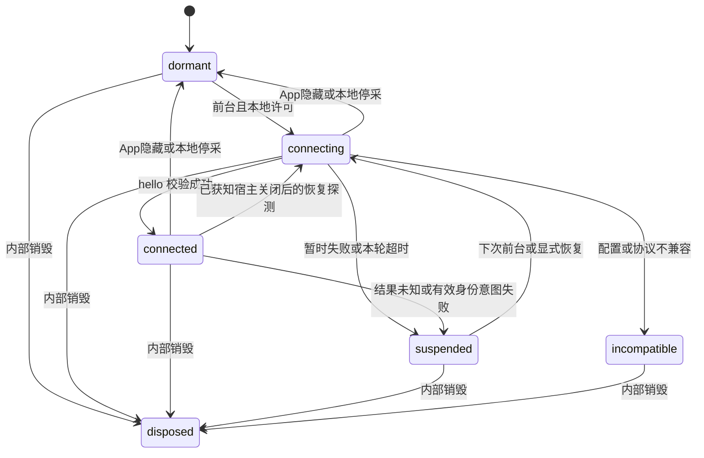
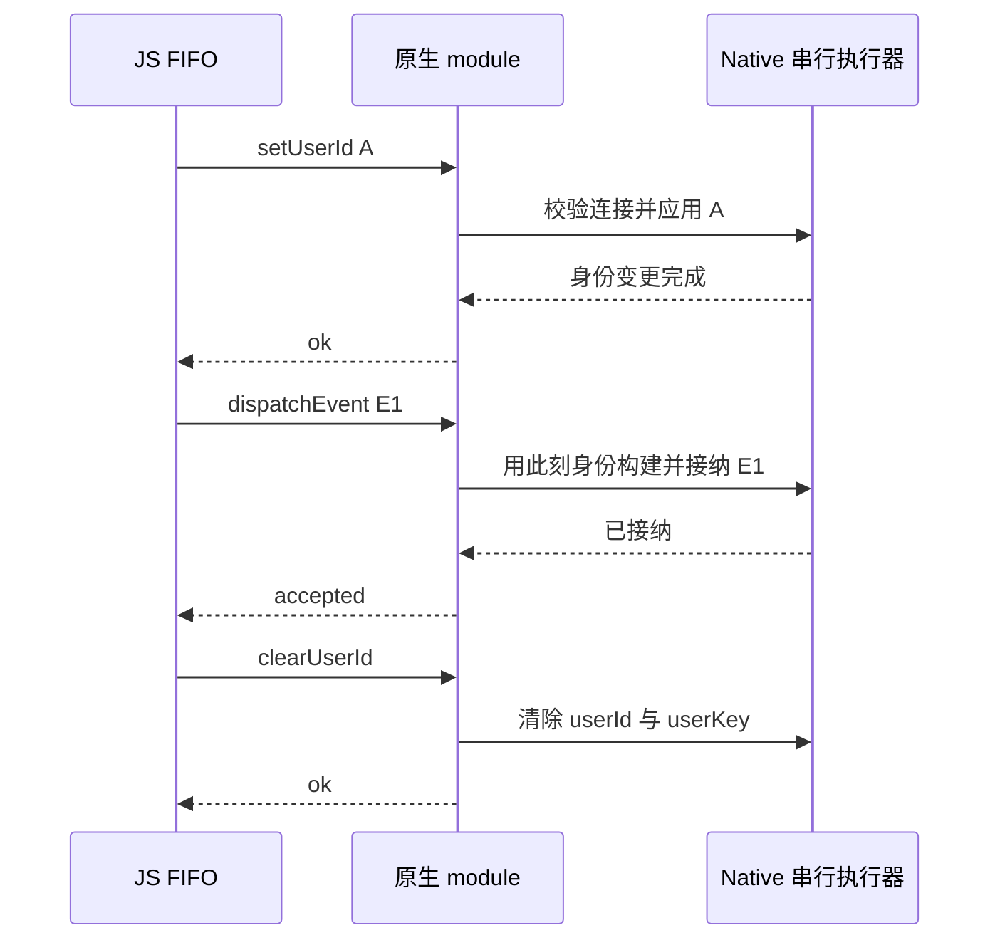

# uniMP Native module 详细契约 v1（设计提案）

> 2026-09-11。与 [总体设计](./unimp-native-hybrid-design.md) 配套，尚未实现。Android / iOS module 按下述能力存在的前提设计；JS 后续可先用测试替身开发，真实原生验收后置。
>
> 文中“必须”表示拟议契约的要求，不表示 DCloud 或当前 GrowingIO SDK 已经具备。模块名、接口、错误码和限额均是本项目提案。

## 1. 不变量与可观察结果

1. 托管模式只有 Native 构建最终事件、分配身份 / 会话 / 序号、持久化与上传；JS 不创建这些状态，不回退 HTTP。
2. 未通过采集门禁，不读取业务属性或输入值，不缓存历史行为；只维护有界页面元信息。
3. 同一客体事件与身份操作共用 FIFO；最多一条有副作用操作在途。不同客体和宿主自身的身份 / 事件最终进入 Native 同一串行执行上下文。
4. 已调用 module 的业务操作不自动重投。结果未知必须显式保留为未知，不能改写成未执行。
5. 有效身份意图失败后保持身份阻断；恢复连接不等于恢复正确身份。
6. 页面行为只关联本连接内已接纳的 PAGE；PAGE 缺失不能静默换成无页面行为。
7. Native 在执行副作用前核对真实调用来源、连接代次、项目数据源、总开关和权限；JS 字段不能充当来源授权。
8. JS 销毁与迟到回调过滤不能代替 Native 关闭容器、拒绝旧请求的职责。

| 对外结果 | 精确含义 | 不代表什么 |
|---|---|---|
| init 返回 true | 同步配置被接受、插件注册窗口关闭，等待生命周期和握手 | module 存在、连接成功、事件已上传 |
| track / 身份命令返回 true | 已形成有界快照并进入 JS 操作队列 | Native 已处理；必须允许后续 onError |
| onReady | 当前 hello 成功，已更新连接与能力状态 | 允许采集、身份已校正或 PAGE 已被原生接纳 |
| dispatchEvent 的 accepted | Native 已完成校验和最终事件构建，并接纳到其受控队列 | 磁盘持久化、HTTP 200、Collector 已入库 |
| 身份命令的 ok | Native 统一身份已完成变更 | JS 创建了一份登录态或自动上报了一条登录事件 |

## 2. 初始化与公开调用矩阵

拟议配置为 `runtime: 'app' | 'unimp'`，缺省继续是 app。unimp 必须有非空 `appId` 和已声明的 `gioHybridAdapter`；本期 transport 只允许 `native-module`。显式出现非 undefined 的 `serverUrl / sessionExpires / appChannel / appVersion` 属于托管模式冲突配置，含 null 也拒绝；不得先套用 App 默认值再决定模式。其余已支持配置仍按现有类型和校验规则执行，不宽泛拒绝 `uniVue` 等合法接入字段。

`appId` 只做首尾空白规范化和长度校验（1–256 个 Unicode 字符），不硬编码 `__UNI__` 前缀；它必须与原生上下文确认的实际 appId 完全一致。项目 / 数据源和 idMapping 也必须一致。初次同步校验失败允许修正后再次 init，保留先前合法插件声明；同步成功后，异步桥接失败不会重新打开注册窗口或允许重复 init。

| 调用 | 连接前 / 本地后台 / 停采 | 正常连接并允许采集 | identityBlocked |
|---|---|---|---|
| track | false，不枚举属性 | 合法草稿进入 FIFO；有当前页面则绑定该页面 | false，不读取属性 |
| 模板 click / change | false，不读取 nativeEvent.value | 先能力 / 敏感校验，再快照；仅当前可见页面 | false，不读取输入 |
| setUserAttributes | false，不枚举属性 | 还要求 penetrateHybrid 和原生 identityWrite | false |
| setUserId / clearUserId | false，不缓存 | 权限和参数合法后进入同一 FIFO | 允许作为明确的恢复命令，仍要求连接、前台和双方许可 |
| setOptions({ dataCollect: false }) | 接受合法布尔值 | 立即关门、清未发队列、结束当前连接代次 | 阻断标记保留 |
| setOptions({ dataCollect: true }) | 前台时发起一次握手；后台仅保存本地许可 | 已连接且状态正常时不重复握手 | 若已连接则等待业务显式身份命令；不会自行解锁 |
| setLocation / clearLocation | false | false，固定原因 location_owned_by_host | false |

当已经是 true 但处于 suspended 时，再调用 `setOptions({ dataCollect: true })` 视为显式恢复机会；这是 unimp 的新增语义，不改变 App 路径。只支持修改 dataCollect，不能运行中切 runtime / appId / transport / idMapping。不开设公开 retry、destroy 或多实例 API。

`penetrateHybrid` 默认 true，但只能在宿主允许时写入宿主全局身份。设为 false 时，身份和用户属性调用直接 false；普通事件仍使用宿主身份。此种已知不支持、非法参数、尚未连接时的调用未进入处理流程，不产生身份阻断；真正进入可处理阶段的合法身份意图发生容量不足、后续丢弃或处理失败，才按第 7 节阻断。

## 3. module、信封与握手

### 3.1 最小接口

```ts
interface GrowingIOUniMPBridgeModule {
  invoke(request: UniMPRequest, callback: (reply: UniMPReply) => void): void
}

interface UniMPHostPort {
  request(request: UniMPRequest, done: (reply: UniMPReply) => void): void
  dispose(): void
}
```

平台适配器独占 `uni.requireNativePlugin('GrowingIOUniMPBridge')`；加载和调用均捕获异常。不要求同步返回对象，不依赖 Promise。即使 mock 同步回调，适配器也延后交给协调器，保证当前 gdp 调用先返回再处理应答，避免重入改变队列。回调不能长期保留或多次作为事件推送。

### 3.2 消息结构

以下为结构定义，整数、长度、字段白名单等约束还需运行时验证；TypeScript 类型不能代替校验。所有对象是普通 JSON 对象，未知字段拒绝，不反射调用任意 Native 方法。

```ts
type EventType = 'PAGE' | 'CUSTOM' | 'VIEW_CLICK' | 'VIEW_CHANGE' | 'LOGIN_USER_ATTRIBUTES'
type Header = {
  version: 1
  requestId: number
  instanceId: string
  generation: number
}
type HostGate = { dataCollect: boolean; containerVisible: boolean }
type HelloRequest = Header & {
  method: 'hello'
  payload: {
    appId: string
    accountId: string
    dataSourceId: string
    idMapping: boolean
    sdkVersion: string
  }
}
type Operation =
  | { method: 'dispatchEvent'; payload: { event: EventDraft; pageViewId?: string } }
  | { method: 'setUserId'; payload: { userId: string; userKey?: string } }
  | { method: 'clearUserId'; payload: Record<string, never> }
type UniMPRequest = HelloRequest | (Header & { connectionId: string } & Operation)

type HelloReply = Header & {
  status: 'ok'
  connectionId: string
  payload: {
    hostType: 'native'
    appId: string
    accountId: string
    dataSourceId: string
    idMapping: boolean
    platform: 'Android' | 'iOS'
    nativeSdkVersion: string
    dcloudSdkVersion?: string
    host: HostGate
    events: EventType[]
    identityWrite: boolean
  }
}
type OperationReply = Header & {
  connectionId: string
  status: 'accepted' | 'ok'
  host: HostGate
}
type RejectedReply = Header & {
  connectionId?: string
  status: 'rejected'
  code: NativeErrorCode
  host?: HostGate
}
type UnknownReply = Header & {
  connectionId: string
  status: 'unknown'
  code: 'native_result_unknown'
  host?: HostGate
}
type UniMPReply = HelloReply | OperationReply | RejectedReply | UnknownReply
```

`EventDraft` 由第 4 节字段表定义，`NativeErrorCode` 由第 9 节枚举定义。本期不传递完整 Native 身份、session、设备标识、任意错误堆栈或回显原始 payload。

| 字段 / 应答 | 校验规则 |
|---|---|
| requestId | JS 运行期内递增的正安全整数，不因换连接而重置；为 hello 和业务请求统一分配 |
| instanceId | 每次真实 JS runtime 新建一次，内部生成，1–128 个 ASCII 字符；不使用设备 / 用户 ID，也不是鉴权凭据 |
| generation | 每次 hello 尝试都递增的正安全整数；重试同样使用新值，不能按墙上时钟生成 |
| connectionId | Native 签发的不可预测、不复用标识，1–128 个 ASCII 字符；请求中的值必须来自本代次成功应答 |
| 协议及 ID | 数字必须是 number，不转换字符串数字；计数器到安全整数上限则停止此 runtime 并诊断，不回绕 |
| 成功应答 | header 必须与当前在途请求一致；业务还需 connectionId 一致；事件只认 accepted，身份只认 ok |
| 拒绝应答 | 合法业务拒绝必须回显同一 connectionId；hello 拒绝不带 connectionId |
| unknown 应答 | 仅用于业务操作的副作用无法确认，必须关联当前连接；与超时一样终止本轮，不能重投 |
| host | 对已绑定来源的每个合法业务成功应答必填；collection_disabled 拒绝必填 dataCollect:false；布尔类型不猜测 |
| 原生版本 / events | 版本字符串非空且最长 64 字符；v1 必须支持上述五种事件；是否允许身份写入由 identityWrite 另行限定 |
| 请求和应答 | JSON 的 UTF-8 编码各不超过 256 KiB；只序列化经过白名单构建的对象，不把整个组件 / 原生事件 JSON.stringify |

Native 对来源尚无法确认或关联字段本身非法的请求，不回显任意输入。可返回最小错误对象 `{ version: 1, status: 'rejected', code: 'invalid_payload' }`；它不属于合法关联应答，JS 不据此结束其他在途请求。正常 SDK 不会生成此类请求。未知版本可在关联字段合法时返回 v1 的 unsupported_version 拒绝；JS 明确终止不兼容连接。

### 3.3 hello 的原生执行步骤

1. module 从实际调用上下文找到“容器本次生命期 + JS 执行上下文”，确认还未关闭、是受信任且获准的 appId。不能只以 appId 为 map key，两个同 appId 容器也必须隔离。
2. 定位宿主唯一 GrowingIO 实例；Android 必要时通过内部 IPC 到达该实例所在进程。未就绪返回 host_not_ready，不初始化客体副本。
3. 校验协议、实际 appId、项目 / 数据源、idMapping；SDK 版本能力符合 v1。配置不同返回 configuration_mismatch，不擅自切数据源。
4. 在与事件 / 身份操作相同的串行执行上下文里，比较当前来源绑定的 instanceId / generation。迟到的旧 generation 不得覆盖较新的连接；JS 上下文重建时先使旧上下文绑定失效。
5. 校验通过后原子替换连接并清空该连接的页面关联及请求高水位，返回新 connectionId 和实际 HostGate。返回 dataCollect:false 或 containerVisible:false 仍可连接成功，但 JS 不采集。

v1 的代次隔离、串行顺序、PAGE 关联、草稿时间保留、domain 归属和真实入队应答是协议硬要求，不另建十几个可选 capability 布尔值。未来破坏这些规则须升协议版本；额外字段 / 事件不能通过“忽略后继续用”来冒充兼容。

hello 不改变身份、不产生分析事件，但会更新连接绑定，因此重试不是复用旧请求；每次新尝试必须使用新 generation。Native 保留每个有效来源的最高代次直至来源关闭，避免迟到 hello 回退状态。

### 3.4 原生操作执行与失效

接收到合法业务请求后，在原生执行副作用的紧邻位置再次检查来源、connectionId、generation、SDK 总开关和操作权限。更新请求高水位后执行；小于或等于已处理 requestId 的重复调用返回 duplicate_request，不重做副作用，也不声称第一次成功。高水位只需进程内状态，不建设持久化去重表。

旧操作若尚未执行，而新 hello 已切换代次，返回 stale_connection。若旧操作已经执行，再收到新 hello，不能撤回；这正是 JS 保留结果未知与身份阻断的原因。容器关闭、来源重建、宿主 SDK 重建时使旧连接失效；不能等待 JS dispose 才清理。

预加载容器 hello 的 containerVisible:false 禁止 JS 建立 PAGE。正常前台采集的消息可能因异步排队在隐藏后执行；Native 不仅凭“执行时已经隐藏”拒绝它，也不以此将宿主重新置为前台。已关闭 / 不再授权的来源仍必须拒绝。HostGate 反馈最新状态供 JS 停止后续接纳，Native 生命周期聚合以真实容器和系统状态为准。

## 4. 事件草稿与字段处理

### 4.1 wire 白名单

所有草稿必须包含 eventType 和 timestamp。timestamp / pageShowTimestamp 是非负安全整数 Unix 毫秒数，保留真实观察值，不因时钟回拨重写。业务排队顺序与超时不用它们决定。可选空字段在 JS 白名单构建后省略；Native 不自动补造页面 / 业务字段。

| eventType | 必填字段（除共同字段） | 可选字段 | pageViewId |
|---|---|---|---|
| PAGE | path | query、title、referralPage | 必填，每次新观察点不同 |
| CUSTOM | eventName | attributes；有关联页时 path、query、pageShowTimestamp | 有当前页面时必填；无页面时不带 |
| VIEW_CLICK | path、pageShowTimestamp、xpath | query、textValue、index、hyperlink | 必填 |
| VIEW_CHANGE | path、pageShowTimestamp、xpath | query、textValue | 必填 |
| LOGIN_USER_ATTRIBUTES | 非空 attributes | 无 | 禁止 |

path / xpath 是非空字符串，query / title / referralPage 是字符串；总长度受报文限额约束。CUSTOM.eventName 使用当前 `^[A-Za-z_][A-Za-z0-9_]{0,99}$`。带页面的 CUSTOM 必须同时带 path 与 pageShowTimestamp；无页面的 CUSTOM 不得携带 path / query / pageShowTimestamp。VIEW_CHANGE 禁止 index / hyperlink；USER_ATTRIBUTES 不附带无意义的页面字段。

`pageViewId` 放在 dispatchEvent.payload 中，不放到 event 中，不进入 collector；长度 1–128 个 ASCII 字符，使用运行期随机标识和递增计数构成，内部再关联 pageKey。它不是根据 timestamp 算出的 hash。PAGE.timestamp、关联行为.pageShowTimestamp、path、query 必须与该 pageViewId 记录一致。

属性归一化直接复用当前 core/protocol.ts 的纯规则：键截至 100 个 Unicode 字符、值截至 1000 个；有限数值 / boolean 转字符串，合法 Date 转 ISO；数组最多 100 项且元素须可归一化，以 `||` 拼接；嵌套对象或非法值按现有规则丢弃该属性；截断后键冲突保留首次值并诊断。Native 只接收已归一化的 string-to-string 对象，不再自行换分隔符或做第二次截断。空属性串、字符串 `"false"` 和 `"0"` 遵守现有属性语义，不当作 false / 0 删除；整体为空的 CUSTOM.attributes 省略，空用户属性调用 false。

自动采集继续复用 schema v2 的精确标识、敏感过滤与文本规范化；textValue / hyperlink 沿用当前去控制字符、trim、100 个 UTF-16 code unit 的上限，不在本功能中悄悄改成另一套 Unicode 截断。index 是满足 `1 <= index < 2147483647` 的整数；tabBar 在原有边界转换为一基序号。桥层接收归一化草稿，不接收 dataset、pickerRange、原始 nativeEvent 或 getter。

最终 event 不接受 JS 提交的 accountId / dataSourceId / platform / domain / deviceId / userId / userKey / sessionId / eventSequenceId / 网络 / 定位等宿主字段。出现越权字段直接 invalid_payload，而不是把整份 Web Hybrid JSON 透传后再覆盖。

### 4.2 Native 构建顺序

来源与状态校验 → 草稿与页面关联校验 → 读取宿主身份 / 会话 / 系统公共字段 → 采用来源绑定的 appId 作为 domain → 按事件类型分配原生序号 → 保留草稿 timestamp 和业务字段 → 构建合法最终事件 → 接纳受控队列 → accepted。

PAGE.orientation 等最终 App 协议必填项由 Native 通过真实上下文补齐，不能用空串凑通过。sequence 按该 Native 事件类型的既有规则处理，不给原本无序号的用户属性事件强加字段。构建时的身份 / session 不在上传重试时重新读取。需要经过原生异步 track thread 的操作，应把构建和入队结果带回，不能在仅投递到线程时提前 accepted。

已 accepted 后存储 / 上传失败由 Native 既有规则负责，不能再回调 rejected 要求 JS 重投。既有返回 void 的 Web bridge 调用、DCloud 通道 success、调用 Native 公共 track() 均不能替代这里的结果反馈。Android / iOS 必须同时核验 JSON、Protobuf 及实际降级序列化格式。

## 5. JS 状态机与触发条件

状态维度保持正交：`phase` 管连接；`localConsent` 管本地许可；`hostGate` 是最近一次可信原生应答；`foreground` 由 JS App 生命周期控制；`identityBlocked` 只反映未校正的身份意图；页面有自己的状态。

`canCollect = phase === connected && localConsent && foreground && hostGate.dataCollect && hostGate.containerVisible && !identityBlocked`。身份恢复操作使用相同条件但允许 identityBlocked 为 true，并增加 canWriteIdentity 校验。VIEW_* 还要求能力已验收且 pageKey 是当前可见页。



| 触发 | 状态与动作 |
|---|---|
| init 成功 | dormant；一次性安装门面和 mixin，不读 App identity / session / queue |
| App.onLaunch | 更新有界入口快照，不自行握手或生成 VISIT |
| App.onShow | 从后台转前台时 foreground=true 并建立新的 foregroundEpoch；本地许可为 true 时开始握手；已经 connecting 不并发开始，前台内重复钩子不新建连接 |
| Page.onLoad | 固定 path / query，分配 pageKey；不采集行为 |
| Page.onShow | 新页面视图计数、更新当前页；满足 canCollect 则安排 PAGE，否则只更新元信息 |
| hello 成功 | 保存连接与 hostGate；canCollect 时为当前已显示页安排一次 PAGE，然后异步 onReady |
| App.onHide | foreground=false；当前页标为本轮不可见，保留必要候选元信息；清未发操作、失效本地代次并进入 dormant；不发 APP_CLOSED，不发 containerState |
| Page.onHide / onUnload | 清该页可见性或释放页状态；不关闭整个 SDK；已经合法捕获的队列条目仍可结束 |
| setOptions(false) | 先关门，再清队列 / timer、失效连接；不等待 Native 回复，不回放旧事件 |
| 收到 host.dataCollect=false 或可见性 false | 停止新采集，清未发队列和页面基线；已接纳的本条照其结果结束，不改写为失败 |
| 下一次前台 / 显式启用 | 开新握手轮；只恢复连接，identityBlocked 独立保留 |
| 事件或身份结果未知 | suspended；本地取消等待并清所有未发操作；不由下一条普通 track 自动解除这种挂起 |
| dispose | 标记 disposed、清 timers / 回调 / 队列 / 页面 / 自有监听，随后所有回调短路；不公开为新 gdp 命令 |

宿主独立关闭后又开启、或预加载容器变为可见但没有新 JS App.onShow 时，允许新的采集尝试触发 hello 探测；触发它的调用当次 false，不读取其属性。该探测只用于已知 hostGate 关闭的状态，每轮起点至少间隔 5 秒，且永远只有一轮；不能绕过结果未知后的 suspended 限制。不设常驻轮询。

首次安装发生在 App 已经显示之后时，只使用框架可确认的当前生命周期 / 页面快照；没有可信 onShow 记录时等待下一次 onShow，不靠调用 init 就推断前台。接入示例仍要求在创建 app 时完成 registerPlugins / init。

### 5.1 有界握手

每轮最多 5 秒，最多 5 次 hello；每次应答窗口最多 1 秒。开始首次请求，失败后按 250 / 500 / 1000 / 1500 ms 的退避等待下一次；超过轮截止时间不再发起，当前请求也由总截止时间终止。module 不存在 / invoke 非函数，本轮直接结束；host_not_ready 或 hello 无有效应答可继续。配置 / 协议 / 来源权限错误不重试。

同一时刻只等待一次 hello；超时后发下一代次时旧 Native 请求可能仍存在，因此必须有第 3 节的 Native fencing。JS 忽略旧代次成功，不能借它恢复连接。

期限由独立 SchedulerPort 管理：调度延迟回调、取消回调；生产端包装 JS 定时器，测试端使用可推进的虚拟调度器。每个待发项建立 5 秒到期标记，发送时取消并换成 1 秒应答计时器；本轮 hello 另有 5 秒总计时器。到期只向协调器提交状态变化，由其集中清理与继续队列。墙上时间仅用于事件 timestamp，不用 Date.now 差值计算 TTL，也不假设 uniMP 一定提供 performance.now。

这些窗口是 JS 调度器中的等待上限，不是主线程阻塞、系统冻结时仍能兑现的硬实时承诺。后台由 onHide 清理；恢复时优先处理已有生命周期 / 到期标记再 pump，框架实际定时器与生命周期顺序必须做真机验证。不要把 Date.now 钳制为非递减就声称解决了时钟回拨。

## 6. FIFO、页面依赖与容量

### 6.1 操作队列

正常接纳次序：检查采集 / 权限 / 当前页面门禁 → 规范化数据 → 构建有限草稿并计算 UTF-8 字节 → 检查容量 → 分配 requestId → 保存不可变快照 → 返回 true → 调度发送。快照的字符串或对象只保留一种主副本，不同时长期保留原始参数、JSON 和完整宿主对象。

所有未发与在途业务操作合计最多 50 条、其规范化 wire 报文合计最多 256 KiB；每条报文亦受同样字节上限。报文限额是 wire / 排队预算，不声称 JS 进程堆只占这么多。hello 不占业务队列但同样受单报文上限约束。新业务操作超限时拒绝最新项，不挤掉较早身份命令给新事件腾位置。

队列项从本地接纳起最多等 5 秒才可调用 module；一旦调用转入最多 1 秒的应答窗口，两段分别计时。到期的普通事件丢弃并继续；PAGE 到期处理其依赖；身份到期按第 7 节终止本轮。身份命令和用户属性不得走旁路抢在事件前执行。

每次调用前重检本地门禁、连接代次与页面依赖；不能因为接纳时通过就绕过其后的本地停采。已调用项无法取消 Native 副作用，JS 只可结束自己的等待。异常、超时、非法的匹配应答均按结果未知处理；不把 invoke 抛错解释成“原生一定没收到”。

### 6.2 页面状态

每个页面交付记录保存 `{ pageKey, viewCounter, foregroundEpoch, pageViewId, reportedPageTimestamp, status }`，status 为 waiting / pending / accepted / unavailable。当前页持有一份，队列中的 PAGE / 依赖项按引用持有对应记录；它与业务页面实例分离，只含纯数据。切换 / 卸载后，只要尚有合法队列项需要它，就保留到这些项终结；回调按自身 pageViewId 更新记录，不能去修改此刻的当前页。记录数量最多为业务队列对应视图数加当前视图，受队列 50 条约束；没有引用即回收。

视图身份与时间分开：时间相同或回拨也能区分两次 onShow。App 从后台回来建立新 foregroundEpoch；前一轮的当前页只能作候选，必须观察到本轮 Page.onShow 才算本轮已显示。hello 先完成则等 Page.onShow 再发 PAGE，Page.onShow 先到则 hello 激活时发 PAGE。不能为上一轮候选先补一条，再为同次恢复的 Page.onShow 又发一条。在未经历 App.onHide 的本地隐私 / 身份 / 连接恢复中，当前可见页仍属于本轮，可以直接建立新观察点。

1. 正常 connected 下真实 Page.onShow：建立新观察点，PAGE.timestamp 为该次观察时间，status=pending，进入同一 FIFO。
2. 页面先显示、握手后完成：用握手激活时刻建立观察点；不重用握手前 shownAt。隐私恢复、身份恢复和重新连接同理。
3. hello 回调与 Page.onShow 相邻：对同一个已记录的 `(pageKey, viewCounter, generation, activation)` 只安排一次 PAGE；激活标识由状态转换生成，不用时间去重。若确实发生下一次 onShow，则是下一次视图。
4. PAGE 仍 pending 时，有效当前页面的 CUSTOM / VIEW_* 可以作为依赖项排在其后。PAGE accepted 后才允许依赖项调用 Native；此时 reportedPageTimestamp 就是该 PAGE.timestamp。
5. PAGE 拒绝、过期、容量不足或被清理：status=unavailable；已排队依赖项以 page_unavailable 结束；新的页面行为在读取属性 / 输入值之前 false。不能继续使用上一个页面基线。
6. unavailable 不因每次点击自动补 PAGE。下一次真实 onShow，或显式 dataCollect 关闭后再开启 / 连接恢复，建立新的观察点。业务埋点不负责驱动补页重试循环。
7. 只有“调用当时确实没有当前可见页”的 CUSTOM 可以不带页面字段。原本来自失效页面的事件不能去掉 path 后作为无页面事件投递。

Native 每个 connectionId 只保存最近一个已接纳 PAGE 的 pageViewId / timestamp / path / query；无需无限页面表。JS 保证旧页捕获的依赖排在下一条 PAGE 前；非当前 pageKey 的迟到探针在快照前拒绝。Native 校验依赖与当前记录完全对应，失败返回 page_unavailable。页面切换中的正常次序是 PAGE_A → A 的行为 → PAGE_B → B 的行为。

pageViewId 表示页面观察关联，不充当 sessionId。Native 会话在页面保持显示时变更，本期不由 JS 额外模拟 VISIT / SESSIONID_UPDATE 或改写旧 PAGE；后续事件按 Native 新会话构建，页面观察时间仍保留。服务端对跨会话页面关联的解释必须加入 T07 / T29 验证；若产品要求新会话必有新的客体 PAGE，则须明确增加 Native 会话通知或补页能力后修订契约，不能在未知会话变化时从 JS 猜测补页。

已交付但结果未知的 PAGE 不原样重发；重新连接后观察到的当前页是新 PAGE，使用新 pageViewId 与恢复时间。它可能造成用户肉眼看似同页的两个分析 PAGE，这是采集断点后的新观察记录，不声称跨故障 exactly-once。恢复不生成客体 VISIT。

### 6.3 入口、页面参数与隐私

当前 page store 的 route / query / title / referral 规则继续复用，但 `reportedPageTimestamp` 不与 shownAt 混用。onLoad query 快照保持既有编码和标量规范，不拼接宿主桥参数。title 在原生导航标题设置成功后更新，已经交付的 PAGE 不回头改写。

入口快照与页面快照分开：仅保留 path、已规范化 query、标量 scene、referrerInfo.appId 等白名单；extraData 默认不保留。单份序列化入口 / 页面元信息上限拟为 16 KiB，不适用 1000 字符的业务属性截断；超限保留必要 path，丢弃可选项并诊断，不暴力截断 percent 编码。若 path 自身超限，该页不可采集。已卸载页面从 store 移除，不保留完整历史栈对象。

未许可阶段允许维护上述必要页面元信息，但不发送 query、标题或入口信息到 hello，也不读取业务属性和输入值。恢复时仅使用当前合法页面快照生成新 PAGE。若业务要求连路由参数也不能留在内存，应在后续单独改变页面生命周期契约，本期不把“无行为缓存”表述成“内存里绝无页面元信息”。

## 7. 身份操作与恢复

setUserId / userKey 复用当前 identity.ts 规则：ID / key 按 Unicode 字符最多 1000，不擅自 trim；空 userId 映射 clearUserId；省略或 null userKey 表示清除旧 key，在 wire 中省略；非空新 key 替换旧值。idMapping=false 时继续按现有规则忽略合法 userKey 并仅固定告警，不让 Native 悄悄沿用旧 key；Native 的 setUserId 不带 key 必须清除旧 key。非法类型 / 超长参数在本地 false，Native 同样验证。

必须保证：`setUserId(A) → track(E1) → clearUserId() → track(E2)` 到达 Native 时，身份生效、E1 入队、清身份、E2 入队依次完成。JS 不自行建 session 或补 VISIT；Native 若按其既有规则在身份变化时更新 session，由 Native 完成。



有效身份意图在容量检查失败、等待过期、队列被清除、Native 拒绝、异常或超时后：先置 identityBlocked=true，结束本地连接代次，再清未发操作并异步 onError。因为代次已失效，旧身份操作的迟到 ok 也不能解除阻断。即使清理是由 App.onHide 或本地停采触发，只要还有未完成身份意图，也保留阻断。

恢复次序固定为：前台 / 显式启用触发新 hello → onReady 通知 identityBlocked:true → 业务根据当前真实登录态重新调用 setUserId 或 clearUserId → Native 明确 ok → 解除阻断 → 为当前页建立新的 PAGE → 接纳其后的事件。已有持久登录态应由业务或宿主维护，SDK 不缓存失败命令并替业务决定重试哪个账号。

新握手成功但宿主当前恰好已是目标用户，也不能仅凭这一猜测解除阻断；本期 hello 根本不返回用户。恢复期间新业务事件 false，不缓存。重复失败继续相同流程。身份恢复成功所触发 PAGE 在处理应答时先入队，再处理之后的用户回调 / 调用，防止行为先于页面。

“按身份命令顺序”只约束实际 Native 串行次序。宿主页面或另一客体可在中间切换账号，所以本期不保证按 JS 事件发生时间绑定历史身份：一个较早发生、较晚被 Native 接纳的事件可能使用接纳时的新用户。5 秒限额只是减少滞留，不消除该情况。若产品未来要求捕获时身份，必须另设计原生身份版本快照及匹配规则，不能声称当前方案已保证。

## 8. 故障、回调与恢复机会

### 8.1 失败范围

| 类别 | 例子 | 后续动作 |
|---|---|---|
| 本地未接纳 | 参数非法、已知停采、无权限、普通事件超限 | 同步 false；不发消息、不重试；固定诊断 |
| 单条明确拒绝 | 普通事件 invalid_payload / queue_full / page_unavailable | 结束该条；PAGE 失败清依赖，其余合法队列可继续 |
| 宿主采集关闭 | collection_disabled 或应答 HostGate 关闭 | 停采、清未发与页面基线；新机会再探测，触发调用不缓存 |
| 连接需重建 | stale_connection / host_not_ready / source_closed | 结束本轮、清未发；等待前台或显式恢复 |
| 不兼容 / 不允许 | unsupported_version / configuration_mismatch / app_not_allowed / unsupported_event | incompatible；不重复握手，需修正宿主或接入配置并重建 runtime |
| 无法判断副作用 | unknown 应答 / timeout / invoke_error / invalid_reply | suspended；不重投本条，清未发；输出 outcome:unknown |
| 有效身份意图失败 | 包含上述所有在接纳流程中发生的身份失败 | 无论原分类，额外设置 identityBlocked；不能只跳过登录继续发送 |

原生关闭是受控状态；若关闭时尚有身份命令未完成，依然设置 identityBlocked。一个已 accepted 的事件应答同时返回 host.dataCollect:false 时，先记录该条已接纳，再关闭后续；不能把实际已接纳改记成 unknown。

### 8.2 应答处理次序

校验报文大小 / 类型 → 检查当前在途 ID、instance、generation、connection → 校验该方法允许的 status 与 payload → 原子结束在途计时器 → 更新成功 / 拒绝及 hostGate → 处理 PAGE / 身份后果与队列 → 延后通知业务。

其他实例 / 旧代次 / 旧 requestId / 已完成请求的回调丢弃。回调无法关联且并非当前有效应答时不取消当前超时；与当前请求完全匹配但字段非法则 invalid_reply，业务操作结果 unknown，hello 可按有界规则重试。重复回调不会释放两次容量或调用两次业务通知。dispose 后连 onError / onReady 也不再触发。

### 8.3 业务回调

```ts
type HybridReadyInfo = {
  collecting: boolean
  identityBlocked: boolean
  canWriteIdentity: boolean
}
type HybridErrorInfo = {
  code: HybridErrorCode
  phase: 'init' | 'handshake' | 'queue' | 'dispatch'
  method?: 'hello' | 'dispatchEvent' | 'setUserId' | 'clearUserId'
  requestId?: number
  eventType?: EventType
  outcome: 'not_sent' | 'rejected' | 'unknown'
  droppedCount?: number
}
```

onReady 每个成功连接代次一次，即使 collecting:false；canWriteIdentity 表示配置与宿主授权同时允许，不等于当前停采时也能执行。允许采集时先安排当前 PAGE，再异步回调。若业务在此刻设置身份，之前安排的 PAGE 可能仍归属先前宿主用户；要求首条 PAGE 就属于登录用户时，应在宿主打开客体前完成登录，不能宣称 onReady 内登录可回写已排 PAGE。

onError 报告握手轮最终失败、同步合法身份意图的入队失败、已返回 true 的操作后续失败；普通同步 false 由返回值与固定诊断表达，不对每次停采点击轰炸回调。单个操作最多一次终态通知；批量清队列用一条通知与 droppedCount 汇总，方法优先指明受影响身份命令，不能丢掉需业务恢复身份的信息。onError 不是每事件成功回调，本期不新增完整 Future / Promise API。

两种回调均在内部状态更新后异步执行。onReady 执行前重检仍是同一有效连接，否则丢弃；onError 报告已发生的失败，即使期间开始新一轮也保留通知，但 disposed 后不通知。异常捕获后只记固定 callback_error 日志，不递归调用 onError。禁止携带 userId / key、query、属性、原始 message、Native exception 文本。debug 可记固定错误码、状态、耗时、队列数量 / 字节、eventType、click/change；沿用 `[GrowingIO]：` / `[GrowingIO Debug]:` 日志前缀。

## 9. 错误码清单

| NativeErrorCode | 含义 |
|---|---|
| unsupported_version | 桥协议不支持 |
| configuration_mismatch | appId / accountId / dataSourceId / idMapping 与可信来源配置不一致 |
| app_not_allowed | 该实际客体来源没有接入权限 |
| host_not_ready | SDK 未初始化或接收入口暂不可用 |
| source_closed | 实际容器或调用上下文已关闭 |
| stale_connection | connectionId / generation 不是当前有效连接 |
| duplicate_request | 本连接 requestId 已处理，不重复执行 |
| collection_disabled | Native 总采集开关关闭 |
| identity_not_allowed | 宿主禁止该客体执行身份 / 用户属性操作 |
| unsupported_event | 事件类型不在 v1 协商支持范围 |
| invalid_payload | 类型、必填、长度、越权或未知字段不合法 |
| payload_too_large | wire 大小超过上限 |
| page_unavailable | 找不到当前连接匹配的 PAGE 基线 |
| queue_full | 原生受控队列暂不能接纳；尚未入队 |
| native_internal_error | 执行前可确认失败，未发生副作用 |

`native_internal_error` 只能用于 Native 能确认未执行的情况；若身份可能已变更或事件可能已入队，不能伪造 rejected。此时返回 `status: 'unknown', code: 'native_result_unknown'`，释放回调并保留脱敏诊断；JS 立即停止该连接。通信本身失败而无法返回时，则由 JS 超时记录 unknown。native_result_unknown 只属于 UnknownReply，不得出现在 RejectedReply 中。

HybridErrorCode 是 NativeErrorCode、native_result_unknown 加以下 JS 固定码：`invalid_config / module_missing / invalid_module / handshake_timeout / invoke_error / invalid_reply / response_timeout / queue_expired / connection_reset / identity_blocked / page_unavailable / local_collection_disabled / local_background / local_queue_full / payload_too_large / location_owned_by_host / unsupported_runtime / metadata_too_large / counter_exhausted`。同名码共用；callback_error 仅内部日志。合法身份命令因任一拒绝失败都走身份阻断。业务遇到未知未来错误码按连接失败处理，不当成功。

duplicate_request 对本 SDK 是异常：从不重投业务请求，正常不应出现；按连接失效处理，原执行结果 unknown，不能把重复拒绝当成第一次肯定未执行。identity_not_allowed 导致本地关闭 identityWrite，普通事件可以继续；如果本次是已进入流程的身份命令，先按阻断终止本轮。需要支持该权限的业务应修正宿主授权后再恢复。

## 10. 后续实现的测试向量

这些是待编写的用例和断言，本次未编写或执行测试。JS 组使用可控制异步回调、调度器和原生串行执行器的契约替身；不能只使用“所有请求立即成功”的 mock。Native 实现仍需独立跑同一 fixture，JS mock 通过不证明真实原生已满足契约。

| ID | 输入 / 故障注入 | 关键断言 | 验证阶段 |
|---|---|---|---|
| T01 | 未声明 Hybrid、缺 appId、冲突 App 配置 | init false、注册窗口保留、无 module 调用和 App storage/request | JS |
| T02 | registerPlugins 后合法 init；module 缺失 | init true、有限失败、无 HTTP / 身份存储副作用、无假桥 | JS |
| T03 | 页面先 onShow，hello 后成功 | 一条恢复时刻 PAGE，无 VISIT；未 ready 事件不补采 | JS |
| T04 | hello 同步回调；onReady 内调用 track | 不重入 gdp；PAGE 在 track 前入 FIFO | JS |
| T05 | hello 超时、重试及旧 reply 迟到 | 总轮次 / 时间有界；旧成功不改变连接 | JS + Native |
| T06 | 两个同 appId 不同容器；伪造 appId / connectionId | 来源隔离；A 不能结束 / 写入 B 的连接 | Native + JS |
| T07 | setUserId A → E1 → clear → E2 | 原生身份快照分别正确，userKey 清除，无本地 session | JS + Native |
| T08 | 身份命令已执行但回调丢失 | 不重投；identityBlocked；hello 后 track 仍 false | JS + Native |
| T09 | T08 后业务明确登录 B 且 ok | 解除阻断；新 PAGE 先于后续 E；A 的历史事件不回放 | JS |
| T10 | 旧身份排在 Native 队列，新 hello 先执行 | 旧操作执行前 stale_connection，不改新身份 | Native + JS 替身 |
| T11 | A 在途，合法 B 因 JS 容量不足被拒绝，A 后到 ok | B 返回 false 且阻断；旧 A ok 不能解锁 | JS |
| T12 | PAGE 被拒绝 / 到期 / 超限 | 依赖 CUSTOM / VIEW 不发送；以后探针不读 value | JS + Native |
| T13 | PAGE pending 后依赖行为，再显示 B 页面 | PAGE_A / A 行为 / PAGE_B 顺序，Native 当前页表有界 | JS |
| T14 | PAGE 接纳结果未知后重新连接 | 不原样重发；只建立恢复时刻新观察 PAGE | JS |
| T15 | 初始本地 dataCollect=false，属性和 value 设 getter | getter 零调用；hello 不发；恢复无历史行为与旧时间 | JS |
| T16 | Native 总开关关闭后 JS 尚未获知 | Native 不接纳；承认通信滞后；获知后 JS 不再取值 | JS + Native |
| T17 | 宿主再次开启但无 App.onShow；业务尝试多次 | 最多一轮 / 5 秒，触发调用 false，不缓存属性 | JS |
| T18 | onHide / setOptions(false) 时有未完成身份与事件 | 清未发、身份阻断；已调用项不可撤回；旧回调无副作用 | JS + Native |
| T19 | 确定未发的普通事件等待超过 5 秒；业务回复超过 1 秒 | 前者过期单条、后者 unknown 并挂起，不混为 HTTP 重试 | JS |
| T20 | 50 条 / 256 KiB 边界，中文、emoji、在途与待发混合 | 按 UTF-8 实际预算，含在途，不因字符数误判 | JS |
| T21 | 响应版本、ID、status、字段类型错误及重复回调 | 正确区分不关联与非法匹配；一次终态 / 一次释放 | JS |
| T22 | Date.now 回拨、同毫秒两次 onShow、长桥接延迟 | viewId 不冲突；期限不延长；timestamp / 页面关联保留 | JS + 设备 |
| T23 | schema v2 click/change、tabBar、敏感输入和重复事件 | 与现有 fixture 一致，VIEW_CHANGE 无 index/hyperlink | JS + 设备 |
| T24 | 数字 / false / Date / 数组 / 嵌套属性及 Unicode 截断 | 复用归一化规则，Native 不二次转换，wire 白名单严格 | JS + Native |
| T25 | App 原生页 → uniMP → 原生页；桌面 → 恢复 | 宿主会话正确，无壳层重复 PAGE / 点击与误发 APP_CLOSED | Native 真机 |
| T26 | Android module 与宿主 SDK 分进程 | IPC 到唯一实例，不创建另一设备 / 会话 / 队列 | Native 真机 |
| T27 | 预加载、隐藏、关闭、同 appId 重开、进程死亡 | 预加载无 PAGE；关闭来源失效；无依赖 JS finally 的清理 | Native 真机 |
| T28 | Native 上传离线 / 重试 / 重启 | Native 独占重试；原事件身份不变；JS 无持久化副本 | Native + 服务端 |
| T29 | PAGE / CUSTOM / VIEW / 用户属性的 JSON 与 Protobuf | 时间、domain、页面关联、序号和字段均正确 | Native + Collector |
| T30 | domain=客体 appId、platform=Android/iOS，两个客体同 path | 服务端页面归档 / 查询正确，区分两客体 | 服务端产品 |
| T31 | npm / uni_modules 生成包与 wgt | 新 core/runtime/platform 文件和类型齐全，mock 不在产物 | JS 发布 + 构建 |
| T32 | 原 App 初始化、插件、身份、启动重放与 HTTP 路径 | 原有 App 契约保持；unimp 不借用 App 缓存重放 | JS 回归 |
| T33 | onError 抛错、onReady 抛错，回调触发新的 API | 无递归错误回调、无状态重入和身份 / 属性日志泄漏 | JS |
| T34 | 超大入口、超长 path、销毁后标题回调、旧页探针 | 元信息有界，当前页关联明确，只清自有资源 | JS + 设备 |
| T35 | Native 明确回 unknown / native_result_unknown | 立即停止本轮、只通知一次、不等超时再通知、不重投 | JS + Native |
| T36 | 后台恢复时 hello 先到 / Page.onShow 先到，残留上一轮页信息 | 同一前台恢复只一条 PAGE；未确认本轮 Page.onShow 不补旧候选页 | JS + 设备 |

T06 的同 appId 隔离也可以通过旧容器关闭后重开、旧回调残留来验证；此处不是声称 DCloud 一定支持同 appId 同时打开多个容器。

### 10.1 供两端对照的消息样例

以下每个 JSON 是 fixture 形式的 request / reply 对，不是直接传给 invoke 的外层对象。实际只传 request，回调返回 reply；所有 ID 和版本值均为演示值。

合法握手，宿主确认允许采集和身份写入：

```json
{
  "request": {
    "version": 1, "requestId": 1, "instanceId": "guest-7a2", "generation": 1,
    "method": "hello",
    "payload": {
      "appId": "__UNI__ORDER", "accountId": "project-demo", "dataSourceId": "source-demo",
      "idMapping": false, "sdkVersion": "example-js-v1"
    }
  },
  "reply": {
    "version": 1, "requestId": 1, "instanceId": "guest-7a2", "generation": 1,
    "status": "ok", "connectionId": "conn-example-1",
    "payload": {
      "hostType": "native", "appId": "__UNI__ORDER",
      "accountId": "project-demo", "dataSourceId": "source-demo", "idMapping": false,
      "platform": "Android", "nativeSdkVersion": "example-native-v1",
      "host": { "dataCollect": true, "containerVisible": true },
      "events": ["PAGE", "CUSTOM", "VIEW_CLICK", "VIEW_CHANGE", "LOGIN_USER_ATTRIBUTES"],
      "identityWrite": true
    }
  }
}
```

当前 PAGE 交付，时间为本次可采集观察点，原生仅回接纳结果：

```json
{
  "request": {
    "version": 1, "requestId": 2, "instanceId": "guest-7a2", "generation": 1,
    "connectionId": "conn-example-1", "method": "dispatchEvent",
    "payload": {
      "pageViewId": "guest-7a2-view-1",
      "event": {
        "eventType": "PAGE", "timestamp": 1789092000000,
        "path": "pages/order/index", "query": "source=home", "title": "订单"
      }
    }
  },
  "reply": {
    "version": 1, "requestId": 2, "instanceId": "guest-7a2", "generation": 1,
    "connectionId": "conn-example-1", "status": "accepted",
    "host": { "dataCollect": true, "containerVisible": true }
  }
}
```

身份结果未知，JS 立即挂起并保留身份阻断；下一轮 hello 使用更大的 requestId / generation，不能重发此 request：

```json
{
  "request": {
    "version": 1, "requestId": 3, "instanceId": "guest-7a2", "generation": 1,
    "connectionId": "conn-example-1", "method": "setUserId",
    "payload": { "userId": "example-user-a" }
  },
  "reply": {
    "version": 1, "requestId": 3, "instanceId": "guest-7a2", "generation": 1,
    "connectionId": "conn-example-1", "status": "unknown", "code": "native_result_unknown",
    "host": { "dataCollect": true, "containerVisible": true }
  }
}
```

## 11. 跨端扩展与交付物

未来 uni-app x 宿主 transport 只替换第 3.1 节通信接口，继续满足来源绑定、代次失效、请求关联、业务 FIFO、身份阻断、PAGE 依赖及接纳应答。宿主仍须提供真正 GrowingIO 接收 adapter；Host Event 的通道成功不代表 accepted。不能只复用 JSON 字段就宣称行为一致。本期不接受一个未实现的 host-event 配置，不新建空 UTS 文件。

JS 实现阶段交付：配置联合类型、门面委派、草稿输出、module transport、协调状态机、回调类型、fixture 和失败可控 mock、两渠道产物、客体 demo 接入文档。Native 后续交付：module 注册与实际签名映射、来源 / IPC / 串行接收、字段 builder、受控队列结果、容器生命周期聚合及自动采集排除规则。

JS 完成标志是上述 JS 用例和适当回归 / 构建通过，可继续开发而不等待 Native；产品“原生打通”完成标志另需 Android / iOS 的 wgt、Native 队列、Collector 报文和产品查询证据。版本矩阵分别记录 JS SDK、Native SDK、DCloud SDK / HBuilderX、OS；各端自动采集能力只有真实验证通过才标记支持。

## 12. 依据

该契约的消息格式是本项目设计。DCloud 提供的是承载能力：[iOS module 调用](https://nativesupport.dcloud.net.cn/UniMPDocs/Extension/ios.html#_4-在-uni小程序-中调用-module-方法)、[Android V2 API](https://nativesupport.dcloud.net.cn/UniMPDocs/API/android-v2.html)、[Android 集成与进程说明](https://nativesupport.dcloud.net.cn/UniMPDocs/UseSdk/android.html)。未来宿主通道参考 [uni-unimp 插件](https://ext.dcloud.net.cn/plugin?id=17638) 与 [Host API](https://nativesupport.dcloud.net.cn/UniMPDocs/UniappHost/unimpapi.html)，实际版本兼容性届时重核。

本地复用边界来自 [入口与插件类型](../index.ts)、[身份语义](../core/identity.ts)、[属性和 App 协议](../core/protocol.ts)、[页面状态](../core/page-store.ts)、[现有启动重放](../core/tracker-event-gate.ts)、[自动采集规范化](../runtime/autotrack-normalize.ts)、[发布目录规则](../scripts/release-layout.ts)。兄弟 SDK 的现场版本与证据见总体设计第 2 节。
