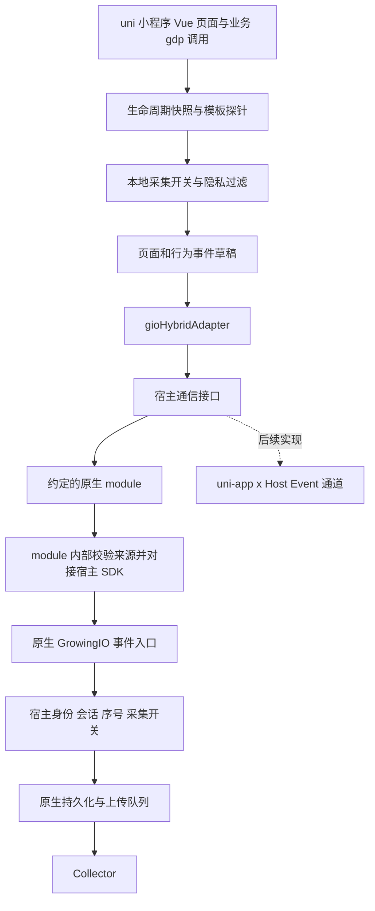

# uni 小程序与原生宿主打通设计

> 状态：待评审设计，2026-09-11。本文中的新增配置、接口、目录和协议均未实现。
>
> 本期目标：传统 uni-app Vue 3 `.vue` 项目作为 `.wgt`，运行在 Android / iOS 原生宿主中，与宿主 GrowingIO SDK 打通。
>
> 已确认的开发前提：Android / iOS 的桥接 module 暂未实现，当前先假设两端提供约定接口，完成 JS SDK 设计；后续 JS 实现可使用测试替身验证，原生完成后再实测对接。当前交付范围仍为设计。
>
> 后续扩展：uni-app x 宿主；本期不实现其通信适配或验收。微信等平台小程序不是本期打通的前置条件。

本文负责范围、职责和工程落点；[module 详细契约](./unimp-native-bridge-contract.md) 是请求格式、状态机和失败处理的唯一详细定义；[设计自审记录](./unimp-native-hybrid-review.md) 记录本轮发现并修正的问题。三份文件均为设计，示例接口尚不可用于当前 SDK。

## 1. 结论与范围

建议采用 **uni 小程序采集页面和业务行为，原生 SDK 统一管理身份、会话及最终上报** 的模式。它对齐 Web Hybrid 的数据归属，同时保留小程序 SDK 的页面和交互语义。

当前仓库按约定的原生 module 契约设计 `unimp` 运行配置、宿主通信和事件交付能力。Android / iOS module 由原生侧后续提供，其暂未实现不阻塞 JS 侧设计和后续开发；整条链路的实测验收安排在原生交付之后。

| 对象 | 含义 | 本期安排 |
|---|---|---|
| 普通 uni-app App | 当前仓库已实现的独立 App 采集 | 保持现有默认行为 |
| 原生宿主中的 uni 小程序 | 原生 App 加载传统 uni-app 的 `.wgt` | 本期设计与后续实现目标 |
| uni-app x 宿主中的 uni 小程序 | 宿主改为 uni-app x，客体仍是传统 uni-app | 预留相同协议和可替换通信接口 |
| 微信、支付宝等小程序 | `mp-weixin`、`mp-alipay` 等构建目标 | 独立扩展方向，不是本期依赖 |
| uni-app x 原生 SDK 嵌入原生工程 | 将 uni-app x 原生模块嵌入 App | 另一种产品形态，不混入本方案 |

DCloud 将 uni 小程序定义为运行在宿主中的 uni-app 前端资源；其生成步骤使用“原生 App 制作 wgt 包”。据此，本方案复用 App 构建与 Vue 生命周期链，不将它识别成 `mp-weixin`。实际运行时返回哪些系统字段，仍需以选定版本的真机记录验证。[DCloud 概述](https://nativesupport.dcloud.net.cn/)、[Android 资源生成](https://nativesupport.dcloud.net.cn/UniMPDocs/UseSdk/android.html)

范围继续限定 Vue 3 `.vue`，不因 DCloud module 支持 `.nvue` 就承诺本 SDK 的 `.nvue` 自动采集。圈选、ABTest、内嵌 H5 再打通、分享归因、微信小程序适配均不在本期。

## 2. 现场源码证据

以下结论来自本次读取的工作区，不是对已发布版本的保证。

| 仓库与 HEAD | 关键文件 | 对设计的影响 |
|---|---|---|
| 本仓库 `33257a1` | `index.ts`、`src/platform/index.ts` | 根入口只创建 App runtime，默认安装存储、网络、HTTP 请求适配器 |
| 本仓库 | `src/platform/system.ts`、`src/types/index.ts` | 系统模型只包含 Android / iOS / HarmonyOS；`domain` 按宿主包名读取，不能区分多个 uni 小程序 |
| 本仓库 | `src/core/dataStore/index.ts`、`src/core/growingIO.ts` | 事件依赖本地 identity、session、sequence 和 queue；只换 TransportPort 仍会创建第二套身份与访问 |
| 本仓库 | `src/core/dataStore/app.ts`、`src/core/dataStore/page.ts` | App 生命周期产生 VISIT / APP_CLOSED，Page 生命周期管理页面与 PAGE，需要按运行模式分配职责 |
| 本仓库 | `src/core/lifecycle.ts`、`src/constants/platform.ts` | 内置插件只有 `gioEventAutoTracking`；现有自动采集能力尚有真机验收门控 |
| Web SDK `8e54d43` | `src/plugins/gioHybridAdapter/index.ts`、`payload.ts`、`src/core/uploader.ts` | 匹配的实例通过 Native 单发；原生配置、身份命令、事件发送和 DOM 圈选分别处理 |
| 小程序 SDK `9c3f601` | `src/core/dataStore/eventHooks/appEffects.ts`、`minipPage.ts`、`eventContextBuilder.ts` | 页面参数和入口参数分开；`domain=appId`，有 scene / keepAlive / 页面补发语义 |
| 小程序 SDK | `src/core/userStore.ts`、`src/core/growingIO.ts#getGioInfo` | session 在内存；`getGioInfo` 是给内嵌 Web 的参数串，不是原生事件接收协议 |
| Android SDK `1a89222` | `growingio-hybrid/.../NativeBridge.java`、`HybridTransformerImp.java`、`WebViewBridgeJavascriptInterface.java` | 有可复用的事件转换逻辑及原生身份读取，但接入类并非公开的 uniMP API |
| Android SDK | `growingio-tracker-core/.../events/base/BaseEvent.java#readPropertyInTrackThread` | 原生重新读取 deviceId、sessionId、userId、dataSourceId、platform，并分配全局序号 |
| iOS SDK `2f7f024` | `Modules/Hybrid/GrowingHybridBridgeProvider.m` | 已有事件重建入口；PAGE 显式读取传入 timestamp，CUSTOM / VIEW_* 当前路径没有同样读取 |

iOS 当前检出源码未找到与 Android 对称的 `getNativeIdentity` 实现。不能从 Web 支持 Promise 的代码，反推当前 iOS SDK 已提供该方法。

主要源码入口：[当前 App runtime](../src/platform/index.ts)、[当前事件构建](../src/core/dataStore/index.ts)、[Web Hybrid](/Users/anoiv/Workspace/gio-web-autotracker/src/plugins/gioHybridAdapter/index.ts)、[小程序生命周期](/Users/anoiv/Workspace/gio-miniprogram-autotracker/src/core/dataStore/eventHooks/appEffects.ts)、[Android 事件入口](/Users/anoiv/Workspace/growingio-sdk-android-autotracker/growingio-hybrid/src/main/java/com/growingio/android/hybrid/NativeBridge.java)、[Android 公共字段](/Users/anoiv/Workspace/growingio-sdk-android-autotracker/growingio-tracker-core/src/main/java/com/growingio/android/sdk/track/events/base/BaseEvent.java)、[iOS 事件入口](/Users/anoiv/Workspace/growingio-sdk-ios-autotracker/Modules/Hybrid/GrowingHybridBridgeProvider.m)。兄弟仓库链接对应本机本次检出的源码。

### 当前仓库必须先具备什么

“支持 uni 小程序”需要先完成下列基础能力，而非先引入完整微信小程序 SDK：

1. 在读取 App identity / session / queue 之前确定运行模式；原生托管模式不创建这些本地状态。
2. 保存客体 `appId`，区分宿主包名、GrowingIO 项目 ID、数据源 ID。
3. 复用 Vue App / Page 的纯数据快照、模板 schema v2 和隐私过滤。
4. 将页面及业务事件构建与 App 公共字段补齐、HTTP 入队分开。
5. 增加宿主握手、事件交付、身份命令和对应诊断；原生 module 自行管理容器可见性。
6. 能力表按“运行模式 × OS × 编译器 / 容器版本”验收，不能继承独立 App 的验收结果。

## 3. 原生 module 接入约定

按用户确认，本期采用 `uni.requireNativePlugin` 获取专用 GrowingIO module。先假设 Android / iOS 都提供相同的异步请求与应答契约；JS 业务、生命周期和事件层不区分原生实现语言及进程。

下面的名称与方法签名是本方案拟定的对接契约，不是已经存在的 DCloud 或 GrowingIO API：

```ts
interface GrowingIOUniMPBridgeModule {
  invoke(message: UniMPRequest, callback: (reply: UniMPReply) => void): void
}

// 仅在 platform/unimp-native-module.ts 中加载，业务页面不直接调用。
const bridge = uni.requireNativePlugin('GrowingIOUniMPBridge')
bridge.invoke(message, reply => done(reply))
```

两端 module 均接收普通 JSON 对象，异步回调协议应答对象；每次调用只完成一次应答。不要求同步返回配置、不假设支持 Promise，也不由 JS 读取 Native SDK 私有类。以后若原生最终的模块名或外部方法签名不同，只在平台适配器内映射；事件协议保持一致。

iOS 官方文档给出了 `uni.requireNativePlugin` 调用自定义 module 的方式。DCloud Android 集成说明中的进程限制，则由原生 module 在内部处理，向 JS 暴露统一的宿主 SDK 能力。[iOS module 扩展](https://nativesupport.dcloud.net.cn/UniMPDocs/Extension/ios.html#_4-在-uni小程序-中调用-module-方法)、[Android 进程说明](https://nativesupport.dcloud.net.cn/UniMPDocs/UseSdk/android.html)

`uni.sendNativeEvent` 及原生事件回调保留为已调研的替代通道，不作为本期 JS 接入路径，也不再要求先创建通用事件分发器。[Android V2 API](https://nativesupport.dcloud.net.cn/UniMPDocs/API/android-v2.html)、[iOS API](https://nativesupport.dcloud.net.cn/UniMPDocs/API/ios.html)

“假设 module 已提供”是开发契约，不是生产降级策略。后续实现中，单元和集成测试可注入 mock module；真实运行时若模块缺失、`invoke` 不可调用或不应答，必须进入对应失败分支，不能安装一个默认成功的假桥，也不能回退 HTTP。

## 4. 总体数据链



客体不依赖 `window.GrowingWebViewJavascriptBridge`；传统 uni-app 的业务逻辑层与渲染 WebView 分离。复用的是 Hybrid 的数据归属和原生事件能力，不是 WebView 注入方式。

同一 JS 运行期仍只存在一个 SDK runtime。多个 uni 小程序分别维护自己的页面状态，最终汇入同一个宿主 SDK。无需引入 JS 多实例插件来模拟 Android 的多个小程序容器。

## 5. 数据、身份及生命周期归属

### 5.1 推荐事件口径

| 事件 / 状态 | uni 小程序职责 | 原生职责 |
|---|---|---|
| VISIT | 不生成宿主访问事件，不创建本地 session | 按宿主整体前后台和原生规则产生 |
| PAGE | 每次有效页面 onShow 形成页面快照；恢复采集时建立新的页面观察起点 | 保留页面字段，补齐公共字段并入队 |
| CUSTOM | 采集事件名、属性、当前页面和发生时间 | 同上 |
| VIEW_CLICK / VIEW_CHANGE | schema v2、`id#eventName`、敏感过滤、去重 | 保留标识、页面关联和发生时间；分配原生序号 |
| LOGIN_USER_ATTRIBUTES | 按身份穿透策略发送属性操作 | 使用宿主当前身份执行 |
| APP_CLOSED | 客体隐藏关闭本地采集门禁，不发送宿主关闭事件 | 由原生容器管理器聚合，宿主整体进入后台才按原生规则发送 |
| setUserId / clearUserId | 通过桥发送身份命令，不另存本地登录态 | 唯一写入方；影响原生及其他客体 |
| setOptions({ dataCollect }) | 只控制此客体是否采集、发送 | 宿主总开关仍优先；不被客体开启 |
| setLocation / clearLocation | 本期托管模式返回 false 并说明应由宿主设置 | 原生定位状态的唯一管理方 |

这里对 VISIT / APP_CLOSED 的处理是本方案的推荐产品口径。如果需要统计“每次进入 uni 小程序”的访问量，可在后续定义专门的业务事件或独立小程序数据模式，不能把它冒充宿主 VISIT。

`setLocation` 的限制需要写入托管模式 API 文档：现有原生事件构建会从宿主重读定位，不能让 JS 返回成功却静默丢弃调用。若本期要支持它，需另行定义“更新全局定位”还是“仅作用于客体事件”，当前推荐不扩大权限。

### 5.2 字段归属提案

此表是待评审的协议扩展建议。现有 [Measurement Protocol](./measurement-protocol.md) 的 App 规则保持有效；本表评审后须正式并入该文件，再实现对应 fixture。

| 字段 | 托管模式取值 / 规则 |
|---|---|
| `deviceId`、`userId`、`userKey`、`sessionId` | 由宿主原生 SDK 在串行接收操作时决定，不接受客体伪造值 |
| `dataSourceId`、项目 ID | 归属宿主；握手必须与 init 预期匹配，不能跨项目转发 |
| `platform` | 推荐仍为宿主 `Android` / `iOS`，与 Web Hybrid 一致；不伪装 `MinP` 或 `web` |
| `domain` | 推荐为客体 DCloud `appId`，如 `__UNI__ORDER`，由宿主来源上下文确认；区别于原生事件的包名 |
| `path`、`query`、`title`、`referralPage` | 来自客体页面快照；`referralPage` 只承载 PAGE 的页面来源，不塞宿主包名或桥接参数 |
| `timestamp` | 正常页面 / 行为实际观察时读取的 Unix 毫秒时间；恢复采集补 PAGE 使用恢复时刻，不回填停采前的时间；Native 不改为收到消息的时间 |
| `pageShowTimestamp` | 此行为关联且已被原生接纳的 PAGE.timestamp；恢复后不能继续使用旧 PageStore.shownAt；Native 构建与序列化必须保留 |
| `eventSequenceId` | 原生唯一分配；JS 请求关联 ID 不进入此字段 |
| `xpath`、`textValue`、`index`、`hyperlink` | 复用当前 schema v2 和字段白名单；点击与变更字段不同 |
| `protocolType` | 本期省略；不为 uni 页面伪造 `https` 或未经定义的 `unimp` 协议值 |
| `appName`、`appVersion`、`sdkVersion`、系统与网络字段、`appState`、定位 | 由原生 SDK 管理；客体 SDK / wgt 版本只用于握手能力与诊断 |
| `appChannel` | 继承宿主渠道；不被客体 scene 覆盖 |
| 客体 `scene`、`referrerInfo` | 保存在内部入口快照；不新增未定义的 collect 顶层字段、不改写宿主会话 |

同一路径在两个客体中通过 `(domain, path)` 区分。进入不同客体时，宿主只选择其已绑定的数据源；`appId` 不是 `accountId`，也不是 `dataSourceId`。

服务端是否按该 domain / platform 组合正确归档页面，必须有 collector 和产品查询验证；HTTP 200 不能代替这一确认。若产品要求独立 `MinP` 数据源，则需要另一套协议及原生入口，不能把现有 Hybrid 原样转发称作实现。

### 5.3 身份命令与事件顺序

推荐 `penetrateHybrid: true`，与 Web Hybrid 的默认身份穿透方向一致。客体登录操作会影响整个宿主登录态，接入文档必须明确这一点；宿主可对每个可信 appId 单独禁止身份写入。

- `false` 时，客体身份写入及用户属性调用返回 false，并输出固定原因；事件仍归属宿主当前身份。不能偷偷保留另一套本地用户。
- `userKey` 只在双方 `idMapping` 契约一致时使用；握手发现不一致则拒绝连接，不静默改配置。
- `setUserId(A) → track(E1) → clearUserId() → track(E2)` 进入同一操作队列，宿主在 GrowingIO 串行执行上下文内依次处理。
- 身份和 session 按 Native 实际处理顺序绑定，JS 的发生时间单独保留。宿主自己切换账号也进入同一串行链；多个客体之间不承诺按 JS 墙上时钟全局排序。
- 有效身份意图一旦发生入队失败、丢弃、拒绝或结果未知，置 `identityBlocked`，终止本轮并清空未发送操作。握手只能恢复连接，不能解除身份阻断；必须由业务重新明确设置或清除身份，且新命令成功，才恢复事件采集。
- 新握手使用递增 `generation` 与原生签发的 `connectionId`；原生在真正执行前拒绝旧代次操作。仅在 JS 忽略旧回调不足以阻止迟到登录修改宿主身份。已经在新握手之前执行的操作无法撤回，仍按上述身份阻断规则恢复。
- Native 对单条操作的身份、session、序号形成一致快照；后续上传重试不再按新用户重新构建旧事件。

本期无需把全量 deviceId / sessionId 同步回 JS。身份继承在原生构建时完成；未来 ABTest / getGioInfo 确有消费需求时，再增加一次性快照读取能力。

### 5.4 Android 多进程与宿主前后台

以下是原生 module 的交付职责与后置联调检查项。JS 侧先按这些职责已被 module 封装的契约开展设计和开发，不以当前缺少原生实现为阻塞条件。

1. GrowingIO 宿主实例只在其所属进程初始化，不在每个 uni 小程序进程重复初始化。
2. 原生 module 从调用所属的 uni 小程序实例和宿主容器记录确定 appid，联调时记录实际进程与 SDK 就绪状态；不把 JS 自报 appId 作为来源凭证。
3. module 若不在 SDK 所属进程，由原生内部完成必要的 IPC 路由；JS 仍只调用同一个 module 接口。真实进程路由在原生交付后验收。
4. 宿主可见性由原生页面与有效 uni 小程序容器共同决定。打开全屏客体不能仅因宿主 Activity 暂停就触发宿主关闭或会话过期。
5. 原生接入层记录 open / show / hide / close 的容器状态。JS App.onShow / onHide 只改变本地采集门禁，不新增 `containerState` 消息，不用一条可能乱序的通知决定宿主会话。
6. 用户返回桌面、客体关闭、进程被杀或宿主关闭时，以原生容器管理和系统生命周期纠正状态，不能只依赖客体最后一条消息。
7. 新旧容器代次分别管理；已关闭容器的迟到 onShow 不能把宿主重新标记为前台。

具体接入点应在 Native SDK 的 Activity / session 状态提供方实现，避免通过反复调用公共 `track()` 伪造生命周期。iOS 同样验证原生页面与客体切换是否多发访问或关闭，但不照搬 Android IPC。

## 6. JS 接入与内部边界

以下为拟议 API，当前版本不能运行：

```ts
gdp('registerPlugins', [
  { name: 'gioEventAutoTracking' },
  {
    name: 'gioHybridAdapter',
    options: {
      transport: 'native-module',
      penetrateHybrid: true,
      onReady: ({ collecting, identityBlocked }) => {
        // 握手成功；身份阻断时，由接入方重新发出已确认的登录或登出意图。
      },
      onError: ({ code, method, outcome }) => {
        // 只处理固定错误码，不输出身份、业务属性或原始报文。
      },
    },
  },
])

gdp('init', 'host-project-id', 'host-data-source-id', {
  uniVue: app,
  runtime: 'unimp',
  appId: '__UNI__ORDER',
  dataCollect: true,
  idMapping: false,
})
```

- 现有默认 `runtime: 'app'` 保留；只有显式 `unimp` 才进入托管流程，不凭某个 `uni.*` 函数存在就改变数据归属。
- `unimp` 必须注册 Hybrid 插件并提供非空 appId。App 模式配置 Native Hybrid 属于错误组合，初始化时拒绝。
- 仍遵守先 registerPlugins 后 init。同步参数失败不关闭注册窗口；参数成功后 init 返回值只表示配置已接受，不代表异步握手、Native 入队或网络发送成功。
- `serverUrl`、App `sessionExpires`、`appChannel`、`appVersion` 等由客体控制独立上报的配置，在托管模式不得默默生效；本期显式传入这些冲突配置则拒绝并给出原因。
- 现有 `gdp` 布尔返回值只表示本地接纳。插件提供可选 `onError` 报告异步失败，避免关闭 debug 后业务无法知道登录失败；不扩展每个业务 API 为 Promise。
- 每次成功握手调用一次可选 `onReady({ collecting, identityBlocked, canWriteIdentity })`，表示连接协商成功。宿主停采或身份阻断时也通知，供接入方决策；不表示事件已上传。允许采集时先安排当前 PAGE，再异步通知。身份阻断期间允许新的 setUserId / clearUserId 作为恢复操作，成功后重新建立当前 PAGE 基线；不再次触发本代次 onReady。回调细节见详细契约。
- 初始登录优先在原生宿主完成。握手前的事件、身份命令和用户属性均返回 false，不偷偷缓存。异步回调仅留在 JS 插件层，不进入协议，业务回调异常不得中断 SDK。
- `transport` 本期只接受 `native-module`；未来新增 `host-event` 时实现同一内部接口，当前版本不接受一个空实现选项。

最小内部接口是请求 / 应答及释放资源，不建立通用 RPC 框架：

```ts
interface UniMPHostPort {
  request(message: UniMPRequest, done: (reply: UniMPReply) => void): void
  dispose(): void
}
```

消息只含可验证的普通 JSON。生命周期、页面实例、函数、代理和宿主对象不穿过接口。超时、请求关联和 FIFO 由 Hybrid adapter 统一管理，module transport 只负责模块加载、方法检查与调用。测试从内部依赖入口注入遵守相同接口的 mock，不向正式业务配置暴露假桥开关。

## 7. 桥接与运行规则摘要

本节仅总结设计；字段、默认限额、状态转移、错误分级和可执行验收用例以 [module 详细契约](./unimp-native-bridge-contract.md) 为准。

| 方法 | 请求 | 成功含义 |
|---|---|---|
| hello | 预期 appId / 项目 / 数据源 / idMapping、版本、连接代次 | 确认来源和能力，建立新的 connectionId；不修改用户、不产生访问 |
| dispatchEvent | 白名单事件草稿、可选 pageViewId | Native 已构建事件并接纳到受控队列；不等于持久化、HTTP 或服务端归档 |
| setUserId | userId 与可选 userKey | 身份已在 Native 统一串行上下文中应用 |
| clearUserId | 空对象 | Native 身份与 userKey 均已清除 |

Native 签发的连接标识绑定真实来源，业务请求必须携带它。每轮新握手使旧连接失效；原生在执行前再次检查代次。请求 ID 只作关联和进程内重复调用防护，不充当事件序号，也不承诺跨崩溃去重。

**托管模式始终只有 Native 一条上报路径。** 不设置 JS HTTP 降级，不创建客体身份、会话、持久化队列或第二份 VISIT。

| 情况 | 默认处理 |
|---|---|
| 首次连接前 | 只维护必要页面状态；事件及身份调用 false，不读取业务属性或输入值 |
| hello 暂时失败 | 一轮最多 5 秒、有界重试；只重试握手，不重投业务操作 |
| ready 后待交付 | 单 FIFO，含身份操作；最多 50 条 / 256 KiB，单条等待发送最多 5 秒 |
| 已调用 module | 同一客体只保留一条业务操作在途；1 秒应答超时后视为结果未知 |
| 普通事件明确拒绝 | 结束此条；PAGE 失败还使依赖该 PAGE 的行为失败 |
| 任意业务操作结果未知 | 不重发，终止本轮并丢弃未发送操作；等待下次前台或显式恢复 |
| 有效身份意图失败 | 额外保留 identityBlocked；下一轮握手成功也不会自动恢复采集 |
| 本地后台或关闭采集 | 停止接纳并丢弃未发送操作；已调用原生的操作不能撤回 |
| module 缺失或不应答 | 明确诊断，业务应用继续运行；不安装默认成功的假桥 |
| 销毁或旧代次回调 | 取消 JS 自有资源、丢弃回调；Native 独立使关闭容器的连接失效 |

页面关联单独维护内部 pageViewId。PAGE 未被 Native 接纳时，其 CUSTOM / VIEW_* 不可越过 PAGE 发送；失效后不能把原有页面行为降成无页面事件。正常前台下，每次页面 onShow 建立新页面视图；握手、隐私恢复或身份恢复补 PAGE 时，使用恢复时刻建立新的采集观察点，不回填停采期间的时间与交互。

有效采集需满足：JS 前台、本地许可、已连接、最近一次原生许可与可见性确认、无身份阻断。Native 对实际交付还要再次核对其总开关；宿主停采到 JS 获知之间存在通信滞后，不能声称瞬时阻止所有 JS getter。原生接纳一条事件时固定身份、会话和序号，后续上传重试不按新用户重新构建。后台前已捕获并已调用的事件可能稍后被原生接纳；不能仅依据接收时容器已隐藏便否定其发生。

onError 只提供固定错误码、方法、请求 ID 和结果分类；debug 沿用现有日志前缀与 click / change 标签，不输出身份、原始 query、属性或桥接全文。详细契约明确哪些错误只影响单条、哪些关闭本轮、哪些要求业务重新校正身份。

## 8. 原生 module 的后续交付约定

Android / iOS 原生侧后续交付 `GrowingIOUniMPBridge` module 或提供与该契约对应的方法映射。当前 JS 侧按下表能力已由 module 封装的前提设计，不在本仓库实现原生 module，也不等待其完成后才开始后续 JS 开发。

| 部分 | Android | iOS |
|---|---|---|
| DCloud 接入 | 注册可通过 `uni.requireNativePlugin` 加载的 module，提供约定 invoke 方法 | 注册同名 module，暴露相同的异步方法契约 |
| 来源 | 从 module 所属的小程序运行实例和容器记录确认来源 | 同样确认，不能仅信任请求体中的 appId |
| 应答 | 完成对应操作后通过 module callback 返回协议对象，只应答一次 | 同样处理，单次调用应答后不继续保留回调 |
| 进程 | 确认到达 SDK 所属进程；必要时内部 IPC | 按实际 SDK 实例所在上下文处理，不建 Android 式 IPC |
| 事件 | 可以复用现有 builder 与序列化基础，显式设置草稿字段 | 可以复用现有 builder；补 CUSTOM / VIEW_* 时间及 pageShowTimestamp 等链路 |
| 身份 | 进入原生串行操作链后确认结果 | 同样处理，不能只在 DCloud 回调线程修改局部副本 |
| 会话 | 聚合原生页面和 uniMP 可见性，避免多进程切换误判 | 验证容器切换、预加载、关闭与宿主前后台 |
| 依赖 | 固定已验证的 DCloud V2、Native SDK 和编译器版本组合 | 固定对应 iOS SDK、Xcode 和编译器版本组合 |

**不直接复用 WebView 私有桥接对象。** Android `NativeBridge` 与 `WebViewBridgeJavascriptInterface` 不是现成公共 uniMP 入口；iOS 现有解析函数也没有完整保留本方案字段。原生侧可在 module 内复用或补齐这些能力，JS 只面向约定的 `invoke(message, callback)`，不依赖原生内部类名。这里描述的是待交付能力，不是要求本次完成 Native 仓库改造。

原生 builder / JSON / Protobuf / 降级格式都要检查，不能只验证 JSON 解析成功。特别确认：PAGE 时间、CUSTOM / VIEW_* 时间、`pageShowTimestamp`、`domain`、`index`、`query` 和属性字符串在最终 collector 报文中一致。

对 uniMP 容器的自动采集还需要去重：避免 Native 对容器壳、渲染 WebView 和内部视图再采一份同名页面 / 点击，避免自动注入 Web SDK 造成第三条链。只排除 uniMP 对应视图，保留宿主其他原生页面的正常采集；具体排除能力必须由两端实测确认。

## 9. 与独立小程序 SDK 的对齐清单

| 能力 | 本期采用的口径 | 保留的差异 |
|---|---|---|
| 接入 | registerPlugins → init → gdp 业务命令 | 不加载独立小程序 SDK，也不重写全局 App / Page / Component |
| 页面 | onLoad 固定路由 / query；onShow 产生 PAGE；onHide / onUnload 更新页面状态 | 客体页面状态独立，宿主 session 统一 |
| title / referral | 复用现有 page store 的标题与来源链，对照小程序 fixture 验证 | 缺失值不编造 |
| 页面与入口 | 页面 query 和 App 入口参数分开；入口快照保留 path / query / scene / referrerInfo | 原生桥配置不混入 query；不把 extraData 整包当作事件属性 |
| 无埋点 | `id#eventName`、click / change、tabBar、正整数 index、敏感规则 | 仅当前 `.vue` 和已支持的模板语法，按 uniMP 单独验收 |
| 用户属性 | 属性归一化、长度限制、字段清理保持一致 | 由宿主身份与身份写权限决定是否执行 |
| 场景与会话 | 保留客体场景快照 | 不按场景变化 / 小程序 keepAlive 改写原生 session |
| 关闭 | 记录客体可见性 | 不独立发 APP_CLOSED |
| 请求频率 | 使用 Native 上传策略 | 不搬运独立小程序 HTTP 节流到桥接通道 |
| 内嵌 Web | 本期不新增 | `getGioInfo` 后续可使用宿主快照；不能直接把旧参数串当 Native Bridge |

独立小程序源码中的 `keepAlive` 与 `sessionExpires` 是两个机制：前者控制后台回前台的访问判断，后者可配置会话过期；不能把两者简单合并为一个 5 分钟选项。当前小程序 `SESSIONID_UPDATE` 也有按页面是否已显示决定补 PAGE 的条件，不能一概写成“永远补”或“永远不补”。这些机制若以后用于独立 `mp-*` 模式，应按当时源码逐条移植，本期托管模式由 Native 会话规则替代。

## 10. 后续 uni-app x 与 mp-* 的扩展方式

### uni-app x 宿主

客体保留同一事件草稿、协议版本、请求 ID、单发策略和身份命令；新增 Host Event transport，把请求经 `uni.sendHostEvent` 发给宿主，再由宿主按 appId 返回带相同 requestId 的协议应答。

`sendHostEvent` 的成功回调仅表示通道操作成功，不等于 GrowingIO 接纳事件。未来 adapter 需使用 `uni.onHostEventReceive` 等回程消息关联真正应答；不能直接把 `{type:'success',code:0}` 转为 `accepted`。[uni-unimp 插件](https://ext.dcloud.net.cn/plugin?id=17638)、[Host 通信 API](https://nativesupport.dcloud.net.cn/UniMPDocs/UniappHost/unimpapi.html)

当前所查插件兼容表对 uni-app x 标注 Android，iOS 不支持；未来版本应重新核验，不能提前承诺两端。该插件是宿主管理 `.wgt` 的能力，不是 GrowingIO 打通插件，本期原生方案不安装它。

扩展时仍要新增 uni-app x 宿主的 GrowingIO 接收 adapter：可能接 uni-app x SDK，也可能接其内部原生能力，取决于实际数据所有者。不能仅更换通信 API 就认为宿主采集职责已实现。

### 微信等平台小程序

以后如果当前仓库明确要支持 `mp-weixin`，增加独立 profile，而不是修改 unimp 的宿主模式：

1. 新增小程序系统 / storage / request / network 适配及完整 MinP 协议构建。
2. `platform=MinP`、`domain=真实小程序 appId`、scene 渠道和宿主版本等对照独立小程序 SDK。
3. 独立 identity / session / VISIT / APP_CLOSED / 上传队列由小程序 profile 管理；按实际平台决定持久化及节流规则。
4. 将 uni-app 编译后的页面生命周期、query / title、模板事件 dataset 与 Vue 小程序适配进行专项验证。
5. 单独处理分享、启动场景、授权、请求域名和平台网络限制；按功能需要逐步扩展。

这些能力无需在原生 uniMP 打通之前实现，也不在本期新建空文件或虚假能力开关。

## 11. 工程落点与实施顺序

沿用当前 `src/` 的领域目录，新增文件只承担已经明确的职责；下表新增模块仍为拟议内容：

| 位置（拟议） | 工作 |
|---|---|
| `index.ts`、`src/constants/config.ts`、`src/core/lifecycle.ts` | 增加 runtime / appId / Hybrid 插件契约，先决定模式再创建依赖 |
| `src/types/index.ts`、`src/core/dataStore/unimp.ts` | 增加内部 EventOutput / 宿主请求接口与协议校验，保留现有 HTTP TransportPort 职责 |
| `src/core/dataStore/protocol.ts` | 复用纯属性和字段校验；新增草稿白名单，不能放松独立 App 报文必填检查 |
| `src/core/dataStore/page.ts`、`src/core/dataStore/index.ts` | 依赖最小事件输出接口，保留共用页面与行为构建；不硬依赖 App composer |
| `src/core/growingIO.ts`、`src/platform/index.ts` | 保持 App 生命周期、持久化和 HTTP 逻辑；抽取真正共用部分供托管 runtime 使用 |
| `src/core/unimp.ts` | 装配页面 / 行为链，替换 App session 及生命周期职责，协调托管门禁 |
| `src/platform/unimp.ts`、`src/platform/unimpNativeModule.ts` | 读取 uni 的客体元信息、加载约定 module、构造宿主端口 |
| `src/plugins/gioHybridAdapter/index.ts` | 握手、FIFO、超时、代次隔离、页面依赖、身份阻断和诊断；沿用 src 中的插件交付目录 |
| `src/constants/platform.ts` | 以运行模式与系统选择已验收能力 |
| `test/contracts`、`test/unit`、`test/integration` | 按统一 module 契约验证请求、应答、故障和编译产物；mock 仅存在于测试路径 |
| `demo` 与后续 Native 示例工程 | 同一客体产出 wgt；原生完成后接入真实 module 验证 |

`core/EventComposer` 不应成为“先造一份伪 App 事件，再删掉公共字段给 Native”的工具。独立 App 路径继续构建完整事件；托管路径直接生成合法草稿，由 Native 构建最终事件。原生桥也不包装成返回 HTTP 200 的假请求端口，否则会错误复用 HTTP 重试和持久化逻辑。

### 11.1 兼容现有入口和插件

根入口仍提供同一 `TrackerRuntime` 门面与单例 `gdp`。当前 `GioPluginRuntime` 直接指向该类，不能让 unimp 返回另一个不兼容的类型。通过门面内委派隔离 App / unimp；不要求业务页面改写生命周期，也不改变先声明插件、同步配置成功后按顺序安装的规则。

`unimp` 的平台预检查只要求实际使用的 Vue 安装与 Native module 加载能力。不能沿用 App 初始化时必须存在 storage / network / request 的判断，否则一个从不直接联网的客体仍会初始化失败。App 路径保留原检查。

| 现有门面方法 | unimp 语义 |
|---|---|
| ready() | 当前连接已通过 hello；不等于允许采集或 PAGE 已接纳 |
| 内部 collecting() 判断 | 当前满足详细契约中的采集门禁；页面行为另受 PAGE 关联约束；它仍是私有方法，不新增公开 API |
| whenReady() | 等待当前握手轮结束并返回连接状态；尚未开始、停采或已挂起时及时返回 false，不无限等待 |
| failed() | 同步配置 / 不兼容的终止失败；临时挂起由诊断报告，不伪装成永久失败 |
| queuedEvents() | 返回空数组；JS 保存的是待交付草稿，Native 最终事件队列不在此进程 |

自定义插件若依赖 App 私有 queue / identity / session，不自动宣称兼容 unimp；使用公开事件及生命周期方法的插件再按能力验证。Native 请求和队列诊断不塞入 `ProtocolEvent[]` 来伪造兼容。

共享事件输出接口只返回 `{ ok: boolean, code?: string }` 一类本地接纳结果；App EventComposer 和 unimp 草稿输出分别实现它。当前 `TrackerEventGate` 的启动重放不能直接用于 unimp：未连接与停采阶段只保留页面元信息，不保留业务事件。模板探针继续通过已有 AutoTrackTarget 接口进入门面，不另建全局分发器。

App 入口快照补足可验证的 scene / referrerInfo；限制大小并只保存允许的标量，extraData 默认不保留。页面 query 仍在 onLoad 固定；标题仅在设置成功后更新。Page.onUnload 仅释放该页状态；SDK 的内部 dispose 才结束运行期。Vue mixin 通常不能卸载，销毁后回调通过运行期标识失效；可移除的拦截器只移除本 SDK 持有的函数引用，不能清空其他插件的拦截器。

### 11.2 构建与发布边界

新增文件落在现有 `core / runtime / platform` 中；同时逐项检查 `tsconfig.build.json`、`scripts/release-layout.ts`、`scripts/check-release.ts` 的入口、声明依赖与 sourceHash。当前发布脚本只收录特定根目录，开发模式可导入不代表 npm 与 uni_modules 都会带上文件。两个渠道均需验证类型入口、产物导入与实际 wgt 构建；禁止把 mock module 打进发布包。

### 11.3 实施阶段

| 阶段 | 交付 | 完成依据 |
|---|---|---|
| 0：设计与契约 | 本文、字段提案、两端共用的 module 名称 / 方法 / 消息约定 | 设计可评审；明确原生尚未实现，但按约定能力设计 |
| 1：JS 契约验证 | module 测试替身、协议 fixtures、正常 / 异常 / 超时 / 顺序场景 | 不依赖真实原生 module；测试替身不进入正式产物 |
| 2：当前 SDK | unimp profile、module transport、Hybrid 插件、模板与页面复用、类型和发布入口 | 使用约定接口与测试替身完成 JS 自动化；独立 App 行为无回归 |
| 3：原生完成后接入 | 原生侧交付 module，JS 适配其实际名称 / 签名，记录容器来源和运行进程 | Android / iOS 真实 wgt 往返，事件和身份操作进入宿主 SDK |
| 4：后置端到端验收 | 多客体、前后台、隐私、登录、字段保留与故障矩阵 | Android / iOS 真机请求、Native 队列与服务端查询形成完整证据 |
| 5：发布 | 支持版本矩阵、接入文档、JS 与 Native 版本配对 | 按项目发布门禁执行；只声明实测通过的功能 |

阶段 1、2 无需等待原生交付；原生侧可独立按同一契约开发，完成后进入阶段 3、4。当前仅交付阶段 0 的设计，不因此启动 JS 或原生代码实现。后续 JS mock 通过时可记录“JS 契约验证完成、原生实测待接入”，不能标记真机打通已完成。uni-app x transport 不混入本期发布。

## 12. 验收矩阵

下表区分两个执行阶段：协议校验、module 缺失、异常、超时、迟到回调与顺序处理可以在 JS 开发期用测试替身验证；跨进程、真实生命周期、Native 字段序列化和服务端归档等待原生 module 完成后实测。Native 当前缺位不阻塞前一阶段。

| 场景 | 必须证明的结果 |
|---|---|
| 冷启动先显示页、后握手 | 无独立 VISIT；就绪后只有一条当前 PAGE；未就绪交互不重放 |
| 原生 → 客体 → 原生 | 同一有效宿主会话；容器切换不误发 APP_CLOSED / VISIT |
| 小程序内跳转、返回、tabBar | page path / query / title / referral 和交互关联正确；不重复采集 |
| Android 同时打开两个不同客体 | 同一路由按 appId 区分；A 回调不能结束 B 请求；共用宿主身份及序号 |
| 预加载、后台、关闭、重新打开 | 预加载不伪造可见页面；旧实例回调失效；关闭后没有泄漏或后台重发 |
| 匿名 → 登录 A → B → 登出 | 行为按串行处理时的身份归属；未产生 JS 本地会话；userKey 正确清除 |
| penetrateHybrid false / 无身份写权限 | 身份和用户属性操作明确拒绝；不影响宿主身份 |
| idMapping、项目 / 数据源不匹配 | 握手拒绝，无部分连接、跨源转发或 HTTP 回退 |
| module 缺失、方法不可调用、加载或调用抛错 | JS 正确失败和诊断，不自动安装假桥；mock 成功仅作为测试证据 |
| 多进程、宿主 SDK 未就绪 | 不创建子进程 GrowingIO 副本；有限等待，有明确错误结果 |
| Native 收到但应答丢失 | 不二次交付；不自动 HTTP 重发；状态未知可诊断 |
| 队列溢出、过期、恶意 payload | 新消息拒绝、内存受限、无循环序列化崩溃；身份失败不会继续污染事件 |
| dataCollect 关闭 / 恢复 | 不读敏感 getter、不缓存停采行为；恢复只补当前页面；Native 总开关优先 |
| 500 ms 桥接延迟 / 时钟回拨 | timestamp 保持实际发生时值；pageShowTimestamp 不丢失，顺序依赖原生序号 |
| schema v2 点击 / 变更 / 敏感输入 | xpath、index、textValue、hyperlink 字段与现有 fixture 一致，原生壳不重复计数 |
| Native 上传失败、离线与重启 | 仅原生队列按既有规则处理；JS 不另建持久化副本 |
| npm 与 uni_modules 产物 | 两种渠道都能构建真实 wgt；依赖和 Native 最低兼容版本清楚 |

验收证据至少记录：JS SDK 版本、Native SDK 版本、DCloud SDK / HBuilderX 版本、OS、客体 appId、运行进程、操作顺序、经脱敏的桥接结果、最终 HTTP 报文和服务端事件查询。自动化、编译、真机、入队、HTTP 成功、服务端正确归档分别记录。

## 13. 评审建议与仍需核验的事实

推荐一次采用以下组合，避免引入多套并行语义：

1. 本期通过 `uni.requireNativePlugin` 调用原生 module；先假设两端提供约定接口，JS 开发使用测试替身，原生完成后再实测。
2. Native 统一数据源、身份、session 和上传；JS 保留客体页面与行为；不补独立 VISIT。
3. `domain=客体 appId`、`platform=宿主 OS` 作为协议扩展提案，以服务端查询验证通过为发布前提。
4. 托管模式不自动 HTTP 回退；调用后结果未知不重投。
5. 身份默认穿透，宿主允许按客体关闭；定位由宿主管理。

原生完成后的联调仍需核验：module 实际签名和运行进程、Native 前后台聚合接入点、两端全部字段序列化、产品对 domain / platform 的解释和去重效果。这些是后置实测事项，不作为当前设计及后续 JS 开发的前置要求。

本次仅完成设计与源码核对，未修改 SDK 实现，未运行构建或设备测试，也未修改 Native / 小程序 / Web 兄弟仓库。
